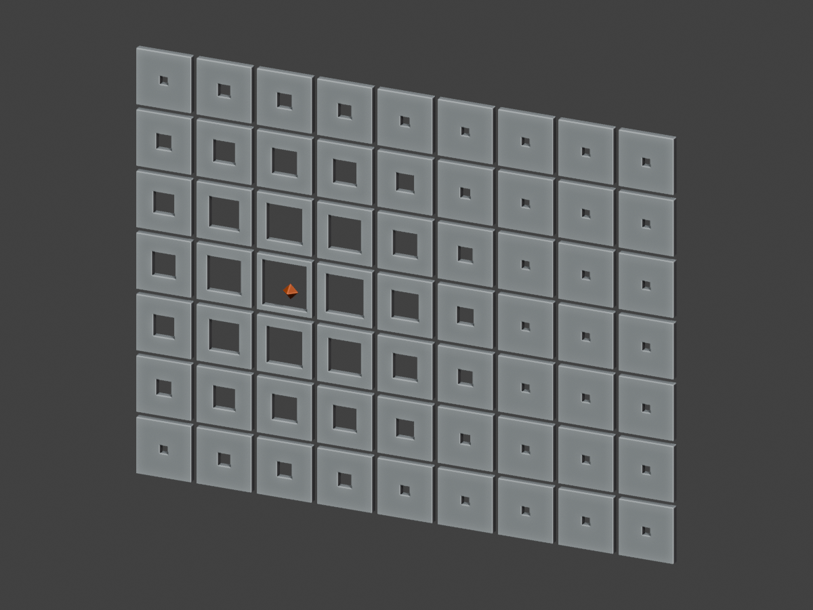
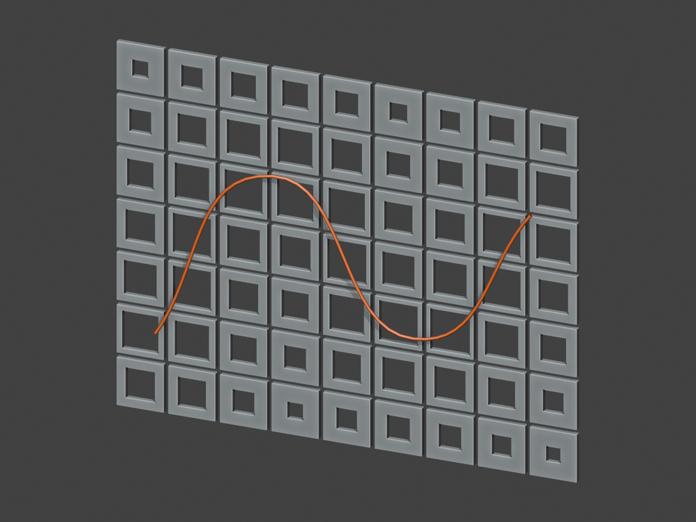

# Attractors — distance becomes a design parameter

Open [Attractors.blend](Attractors.blend) in Blender 5.2.1 LTS or a compatible newer version. Choose the numbered scenes from the Scene selector. Select the object with the scene's name to see its Geometry Nodes. Press **Home** over the node editor to fit the graph, and **Ctrl+Space** to enlarge it.

**An attractor is a reference you place in the model.** Each panel measures how far it is from that reference. We turn that distance into a useful number, such as scale, opening width, depth or rotation. Nothing moves or deforms automatically: the socket receiving that number determines what changes.

**A field is a rule that can give a different value at each location.** Here the rule is “measure distance, then remap it.” The same rule produces 63 values across the 9 × 7 facade.

## Teaching sequence

The eight scenes are prepared checkpoints within one lesson, not eight assignments. Scenes 02–04 teach the three distance methods. Scenes 06–08 repeat those methods with the same reusable panel.

| Scene | Explain and demonstrate |
|---|---|
| 01 — Read the field | Each bar's height shows the value at one location. Move Point A and watch the values change together. |
| 02 — One point | One distance measurement controls the size of repeated blocks. |
| 03 — Multiple points | Two distance measurements enter Minimum: the nearer point controls each block. |
| 04 — Curve attractor | Measure distance to the nearest location along a curve, not just its control points. |
| 05 — Panel prefab | Change Opening on one reusable panel. Its outside stays 1 × 1; only the square hole changes. |
| 06 — One point opening | Send the attractor value into the prefab's Opening input, once per panel. |
| 07 — Multiple point openings | The same prefab uses the distance to the nearer of two points. |
| 08 — Curve openings | The same prefab uses distance to a curve. |

Start with one point. Explain Map Range once, then keep it unchanged while introducing the other distance sources. Finish by replacing the scale response with the opening response. Scenes 07–08 are ready-made comparisons if time is short.

## Copy the nodes, read the frames

Built-in nodes retain their native names and have no custom labels. For example, search for **Vector Math**, then choose **Distance**; its header shows the selected operation. Explanations appear only on Frames. `Panel - Opening` is the name of our custom reusable node group.

### 1. Locations

**Grid → Transform Geometry** makes the same 9 × 7 vertical facade in every array scene. Grid size is 8.8 × 6.6, so locations are 1.1 apart. Transform Geometry rotates it 90° around X and moves it 3.3 along Z. The lesson object itself stays at the origin with identity transforms.

**Position** means the location being evaluated on this grid. It is not the attractor's position.

### 2. Measure distance

- **One point:** Position + Object Info **Location** → Vector Math set to **Distance**. Move the empty named `Point A - move me`. Object Info uses **Relative**, keeping both positions in the lesson object's coordinate system.
- **Multiple points:** repeat the same Distance setup for Point B, then send the two numbers into Math set to **Minimum**. This chooses the nearer attractor. It does not average or add the influences. Add another Distance and Minimum for a third point.
- **Curve:** Object Info **Geometry** → **Curve to Mesh** with no profile → **Geometry Proximity**, target **Edges**. Connect Position to **Sample Position** and use **Distance**. Curve to Mesh provides evaluated edges along the curve; using Points would measure only the vertices. The visible orange stroke is a separate display copy, so its thickness does not alter the measured distance.

Move the curve object or edit its Bezier control points. The curve is evaluated as short straight edges: increase curve resolution if a very tight bend looks segmented.

### 3. Remap

All three methods feed one **Map Range**, set to **Float**, **Linear**, with **Clamp** enabled.

| Input | Meaning | Scale examples | Opening examples |
|---|---|---|---|
| From Min | Distance at the attractor | 0 | 0 |
| From Max | Distance where the response reaches its far value | 4 | 4 |
| To Min | Response near the attractor | 1 | 0.85 |
| To Max | Response far from the attractor | 0.25 | 0.15 |

At distance 2, the opening is 0.50. At distance 4 or farther, it stays 0.15. Swap To Min and To Max to reverse the effect. Change From Max to change the reach. Keep From Max greater than zero.

Scene 01's optional Viewer branch receives the grid and the remapped value. Activate that Viewer and inspect its Value column in the Spreadsheet to connect the numbers to what you see.

### 4. Choose what the number controls

**Scale response (02–04):** Map Range Result → Instance on Points **Scale**. A scalar connected to Scale affects X, Y and Z equally. Scene 01 instead uses Combine XYZ to change Z only. Realize Instances and Set Material are display steps after the response.

**Prefab parameter response (06–08):**

1. Grid locations enter **For Each Geometry Element**, set to the **Point** domain.
2. Its input items are a Vector named **Panel position** and a Float named **Opening**. Position and Map Range Result enter these inputs outside the zone.
3. Inside the zone, Opening connects to `Panel - Opening` → **Opening**. This is one number for the current panel.
4. The prefab's geometry enters **Transform Geometry**. Rotate 90° around X and connect Panel position to Translation.
5. Connect the transformed panel to the zone's **generated Geometry** input. Use the matching generated Geometry output for the result.

The first Geometry output of the zone is the original input geometry. Use the generated output for the new panels. This zone builds a panel at each location; it is not a Repeat Zone accumulating one operation after another.

**Why the zone?** Instance on Points repeats already-built geometry. It can vary instance transforms, but it does not rerun an arbitrary prefab with different construction inputs for each instance. This small zone makes that step explicit.

## Your own module goes here

First make the student's panel work by itself as a node group, centered at its local origin. Expose the intended parameter and a Geometry output. Test two parameter values manually before connecting an attractor.

Replace `Panel - Opening` inside the zone with that group. Connect the zone's Opening value to the student's intended input, which could instead be Depth, Height, aperture or angle. Adjust Map Range's To Min and To Max to safe values in that parameter's units. Keep the location input and final Transform Geometry. Adjust the final rotation only if the module was built in a different plane.

The supplied prefab is deliberately simple: a cube minus a taller cutting cube. Its square outside is 1 × 1, its thickness is 0.12, and Opening is the hole's width in model units, not a percentage. Use 0.10–0.90 to retain a border. It demonstrates the connection method; students reuse their own 3.1 panel for the assignment.

For the existing Geometry 101 pyramid, the same connection can drive **Height** on `002-point in middle`; use a suitable height range and orient that module for the intended facade. More than one parameter can be driven by using separate Map Range nodes from the same distance.

## Demonstration checks

1. Move the attractor: nearby panels should respond immediately.
2. Swap the Map Range output values: the same locations now give the opposite pattern.
3. In the two-point scene, move one point away: the other still controls its nearby region.
4. In the curve scene, edit a middle control point: the response should follow the changed curve.
5. In the opening scene, compare near and far panels: their outside dimensions and thickness remain fixed; their holes differ.
6. If all panels are identical, check that the value enters the zone outside it and reaches the prefab input inside it.

## Assignment connection

For **3.4**, show the same facade and controlled panel parameter with one point, multiple points and one curve. For **3.5**, reuse that panel to design a simple architectural facade, wall or similar application. The three studies and architectural application remain the existing two-sheet submission; these teaching scenes add no deliverables.

## Node setups and results

These are native Blender editor screenshots. Open a link for the full-size image.

| Method | Scale setup | Opening setup | Opening result |
|---|---|---|---|
| One point | [Nodes](../../../images/blender/attractors/02-nodes.png) | [Nodes](../../../images/blender/attractors/06-nodes.png) | [View](../../../images/blender/attractors/06-result.png) |
| Multiple points | [Nodes](../../../images/blender/attractors/03-nodes.png) | [Nodes](../../../images/blender/attractors/07-nodes.png) | [View](../../../images/blender/attractors/07-result.png) |
| Curve | [Nodes](../../../images/blender/attractors/04-nodes.png) | [Nodes](../../../images/blender/attractors/08-nodes.png) | [View](../../../images/blender/attractors/08-result.png) |

The file includes this guide as the Text datablock **START HERE - Attractors**. Save your own working copy.

[Course file index](../README.md) · [Current syllabus](../../../syllabus/ARC3133_Syllabus_Fall2026_STUDENT.md)
