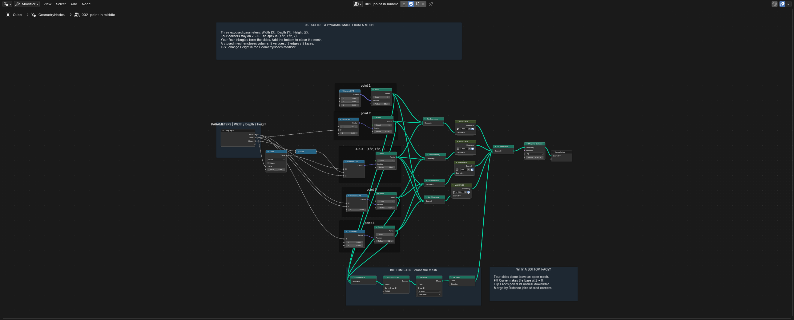
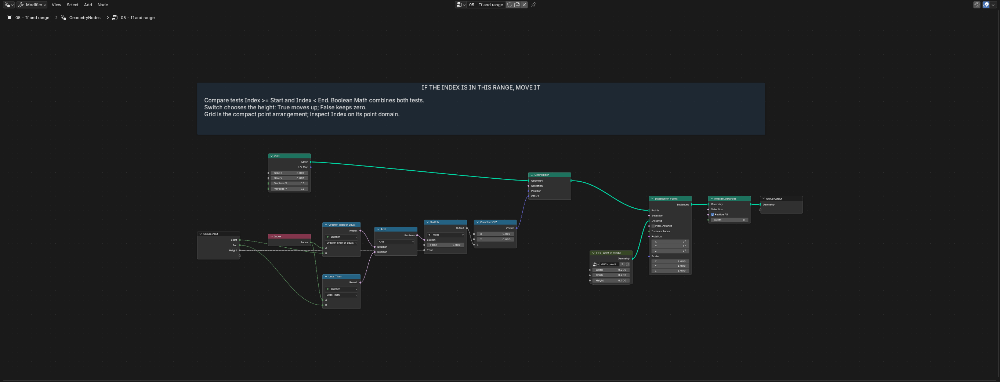
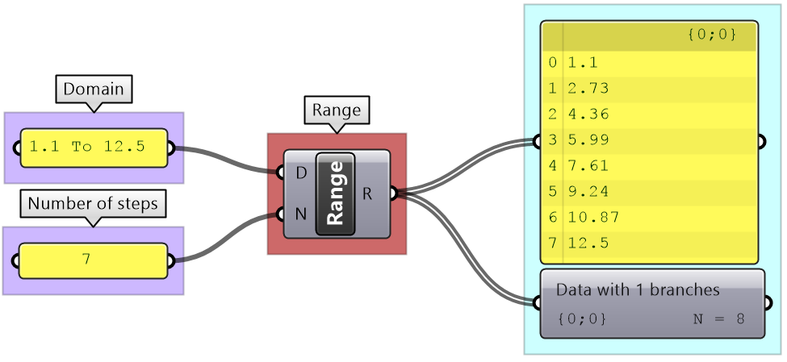
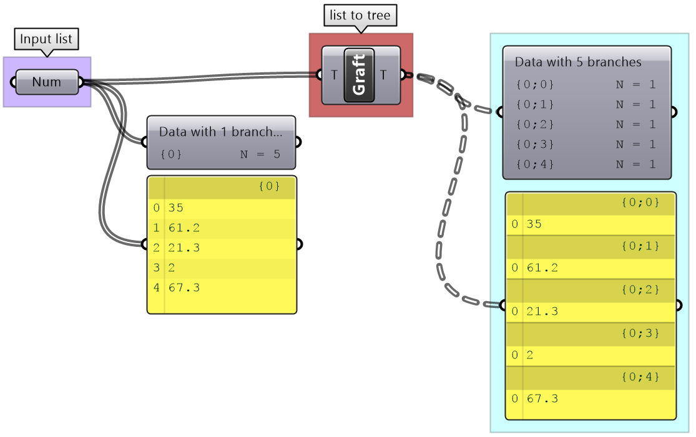
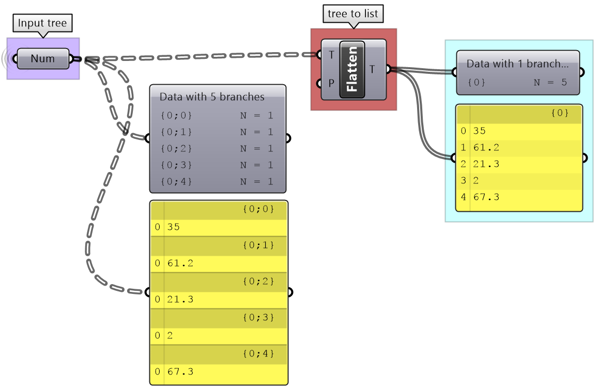
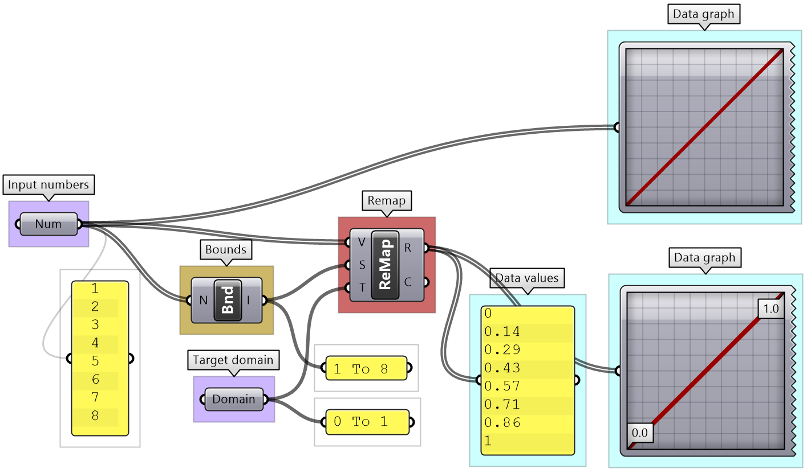
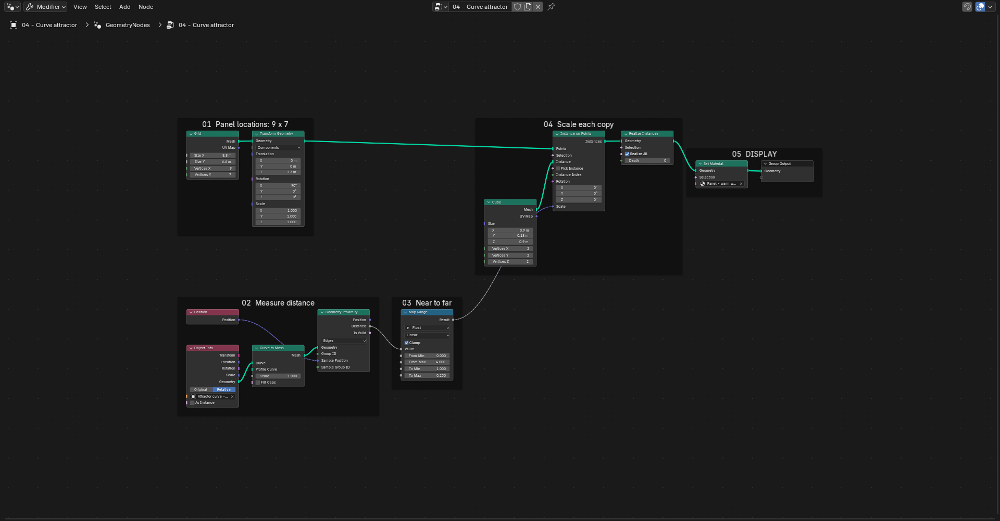

<!-- Generated from syllabus/vocabulary.yml by scripts/sync_course.py. Edit the source, not this copy. -->

# Vocabulary by assignment

Use this page while working on an assignment: each entry explains **what it is**, **how we use it** and where to read a fuller explanation. The examples use ordinary language; you do not need to memorize formal definitions or reproduce equations.

The references are optional reading from Wikipedia, Python and software documentation, and a university library. They explain the underlying concepts; the assignment briefs define what to submit. Some tool names differ between Blender Geometry Nodes and Grasshopper.

**Node examples:** GN means Geometry Nodes; GH means Grasshopper. Selected entries include actual course captures or attributed documentation screenshots. Click an image to inspect the full screenshot. Graft and Flatten describe GH data-tree operations, not changes to a shape's geometry.

<a id="assignments"></a>

## Find your assignment

- [1 · Graphic Standards Manual](#gsm)
- [2.1 · CSG architectural object](#csg)
- [2.2 · Slicing and 3D printing](#printing)
- [3.1 · Descriptive geometry and the parametric module](#module)
- [3.2.1 · Arrays and repetition](#arrays)
- [3.2.2 · Conditionals and patterns](#patterns)
- [3.2.3 · Architectural application](#application)
- [3.4 · Attractor studies](#attractors)
- [3.5 · Architectural facade or small project](#facade)
- [4.1 · Volumetric field matrix](#fields)
- [4.2 · Architectural envelope](#envelope)
- [4.3 · Contour fabrication](#fabrication)
- [Final booklet · Communicating the work](#booklet)

## Programming essentials

The aim is to read a small program, predict what changing an input will do, modify one rule and inspect the result when it fails. Use the short examples as a bridge between Python and the node work. Each example runs independently in ordinary Python and prints numbers or lists; geometry creation happens in the modeling software.

- [2.1: Follow a dependency](#python-csg)
- [3.1: Reuse a function to make panel corners](#python-module)
- [3.2.1: Build a small grid with nested loops](#python-arrays)
- [3.2.2: Combine a repeating pattern with a height test](#python-patterns)
- [3.4: Inspect a value before and after clamping](#python-attractors)
- [4.1: Repeat a random sequence](#python-fields)
- [Debugging checklist: find the first unexpected result](#debugging)

<a id="gsm"></a>

## 1 · Graphic Standards Manual

Make a set of graphic rules you can reuse throughout the course.

### Design system / graphic standards

**What it is:** A shared set of rules that makes different pages look like they belong together.

**How we use it:** Choose consistent colors, type, spacing and line styles, then apply them to every assignment.

[Read more: Design system / graphic standards — Wikipedia](<https://en.wikipedia.org/wiki/Style_guide>)

### Color palette and color theory

**What it is:** A palette is your chosen set of colors. Color theory helps explain their relationships, such as complementary colors opposite each other on a color wheel.

**How we use it:** Choose up to two colors plus a white or dark background. Explain their relationship; a full triad has three colors, so identify a two-color selection if using that strategy.

[Read more: Color palette and color theory — Wikipedia](<https://en.wikipedia.org/wiki/Color_theory>)

### HEX / RGB

**What it is:** Two ways of recording a screen color. RGB gives its red, green and blue amounts; HEX writes those amounts as a six-character code.

**How we use it:** Record either HEX or RGB so you can reproduce the same palette on every sheet.

[Read more: HEX / RGB — Wikipedia](<https://en.wikipedia.org/wiki/Web_colors>)

### Typography

**What it is:** The choice and arrangement of letters so text is readable and has a consistent character.

**How we use it:** Choose typefaces and sizes for titles, subtitles, body text and captions.

[Read more: Typography — Wikipedia](<https://en.wikipedia.org/wiki/Typography>)

### Visual hierarchy

**What it is:** A clear order of attention: what someone notices first, second and third.

**How we use it:** Make the project title easy to find, then guide the reader to the main image and its explanation.

[Read more: Visual hierarchy — Wikipedia](<https://en.wikipedia.org/wiki/Visual_hierarchy>)

### Composition and white space

**What it is:** Composition is how you arrange a page. White space is the space left between elements, even on a dark background.

**How we use it:** Balance images and text, leave room around them and make the reading order clear.

[Read more: Composition and white space — Wikipedia](<https://en.wikipedia.org/wiki/Page_layout>)

### Grid and template

**What it is:** A grid is an invisible alignment guide. A template is a reusable page setup built around that guide.

**How we use it:** Keep margins, title positions, image areas and page numbers consistent across your 17 × 11 inch sheets.

[Read more: Grid and template — Wikipedia](<https://en.wikipedia.org/wiki/Grid_(graphic_design)>)

### Line weight and line style

**What it is:** Line weight means thickness; line style means solid, dashed or another pattern. Together they distinguish different kinds of information.

**How we use it:** Use heavier outlines for emphasis and lighter or dashed lines for secondary or hidden geometry. Keep the system consistent.

[Read more: Line weight and line style — Wikipedia](<https://en.wikipedia.org/wiki/Architectural_drawing>)

[Back to assignments](#assignments)

<a id="csg"></a>

## 2.1 · CSG architectural object

Describe a real architectural object as a repeatable sequence of simple operations.

### Precedent

**What it is:** An existing project you study to understand a design idea or method.

**How we use it:** Document a real building, identify its main shapes and explain how your model interprets them.

[Read more: Precedent — University library guide](<https://guides.library.illinois.edu/architecture/Researching_Buildings>)

### Node graph / visual programming

**What it is:** A program built by connecting blocks. Inputs enter a block, the block performs an operation and outputs pass results onward.

**How we use it:** Connect geometry and controls in Geometry Nodes or Grasshopper, and follow the connections to explain what happens.

[Read more: Node graph / visual programming — Wikipedia](<https://en.wikipedia.org/wiki/Visual_programming_language>)

### Inputs, outputs and dependencies

**What it is:** Inputs are what an operation receives; outputs are what it produces. A dependency means one result needs another value or result first.

**How we use it:** Follow a cutting solid through Transform and Boolean. Changing its size affects the later cut. In a Python script, dependent calculations must run again after an input changes.

[Read more: Inputs, outputs and dependencies — McNeel Grasshopper guide](<https://developer.rhino3d.com/guides/grasshopper/gh-algorithms-and-data-structures/algorithms-data/#12-algorithms-parts>)

### Naming and comments

**What it is:** Names identify values or steps. Comments explain intent without running an operation.

**How we use it:** Use opening_width instead of an unexplained x. A Python comment starts with #; node labels and frames explain the same intent in a graph.

[Read more: Naming and comments — Python documentation](<https://docs.python.org/3/tutorial/introduction.html>)

### Primitive and solid

**What it is:** A primitive is a simple starting shape, such as a box or cylinder. A solid encloses a volume.

**How we use it:** Start the architectural massing with a few simple solids before cutting or combining them.

[Read more: Primitive and solid — Wikipedia](<https://en.wikipedia.org/wiki/Constructive_solid_geometry>)

### Transformation

**What it is:** A change to a shape's position, size or orientation. Translate means move; scale means resize; rotate means turn.

**How we use it:** Move a box into place, stretch it to the right proportions and rotate a cutting shape.

[Read more: Transformation — Wikipedia](<https://en.wikipedia.org/wiki/Transformation_(geometry)>)

### CSG and Boolean operations

**What it is:** Constructive Solid Geometry builds forms by combining solids. Union joins them, difference subtracts one from another, and intersection keeps only their overlap.

**How we use it:** Join building masses, cut out a courtyard or retain the shared volume of two shapes.

[Read more: CSG and Boolean operations — Wikipedia](<https://en.wikipedia.org/wiki/Constructive_solid_geometry>)

### Procedure / pseudocode

**What it is:** A procedure is an ordered set of instructions. Pseudocode describes those instructions in readable steps without requiring a working programming language.

**How we use it:** Write steps such as 'make a box, move the cylinder, subtract it' and match them to your process diagrams.

[Read more: Procedure / pseudocode — Wikipedia](<https://en.wikipedia.org/wiki/Algorithm>)

### Process diagram

**What it is:** A drawing that explains how a design changes from one step to the next.

**How we use it:** Use white building masses, color to show changes, clear outlines and a final view with context.

[Read more: Process diagram — Wikipedia](<https://en.wikipedia.org/wiki/Architectural_drawing>)

<a id="python-csg"></a>

### Read, predict, change, inspect

#### Follow a dependency

```python
width = 2
height = 3
area = width * height
width = 4
print(area)  # The earlier result is still 6.
area = width * height
print(area)
```

**Expected output:**

```text
6
12
```

**Connection to node work:** GN Math → Multiply and GH Multiplication calculate the area. Connected graphs normally recalculate affected outputs when inputs change. Python assignments run in sequence: changing width does not automatically rerun the earlier area calculation.

**Try it:** Before running it, predict both results. Change height, then identify which calculation needs to run again.

[Back to assignments](#assignments)

<a id="printing"></a>

## 2.2 · Slicing and 3D printing

Understand how a digital object becomes a physical print and anticipate common problems.

### Slicer and toolpath

**What it is:** A slicer turns a model into printable layers. A toolpath tells the printer where to move and deposit material.

**How we use it:** Inspect the layer preview before printing and check the planned walls, infill, supports and travel moves.

[Read more: Slicer and toolpath — Wikipedia](<https://en.wikipedia.org/wiki/Slicer_(3D_printing)>)

### Layer height and walls / perimeters

**What it is:** Layer height is the thickness of each printed step. Walls, also called perimeters, form the shell around the object.

**How we use it:** Balance surface quality, print time and a shell strong enough to handle.

[Read more: Layer height and walls / perimeters — Prusa documentation](<https://help.prusa3d.com/article/layers-and-perimeters_1748>)

### Infill

**What it is:** The pattern of material inside the printed shell.

**How we use it:** Use enough internal support for a successful object without unnecessarily filling the entire volume.

[Read more: Infill — Prusa documentation](<https://help.prusa3d.com/article/infill_42>)

### Orientation, overhang and supports

**What it is:** Orientation is how a model sits on the bed. An overhang extends beyond the layer below; supports provide temporary material underneath where needed.

**How we use it:** Rotate or split the model to reduce supports, then check whether remaining supports can be removed.

[Read more: Orientation, overhang and supports — Prusa documentation](<https://help.prusa3d.com/article/support-material_1698>)

### Bridging

**What it is:** Printing across a gap with support at both ends.

**How we use it:** A short opening may bridge successfully without supports; check the preview and test what the printer can handle.

[Read more: Bridging — Prusa documentation](<https://help.prusa3d.com/article/poor-bridging_1802>)

### Bed adhesion / first layer

**What it is:** How well the first printed layer sticks to the build surface.

**How we use it:** Check the first layer and contact area so the object stays in place during printing.

[Read more: Bed adhesion / first layer — Prusa documentation](<https://help.prusa3d.com/article/first-layer-issues_1804>)

[Back to assignments](#assignments)

<a id="module"></a>

## 3.1 · Descriptive geometry and the parametric module

Build a documented panel from points and faces, then change it through a few clear controls.

### Point and coordinates

**What it is:** A point is a location. Its X, Y and Z coordinates describe where it is relative to the model's origin.

**How we use it:** Write the positions needed to construct the panel and show them in an indexed point list.

[Read more: Point and coordinates — Wikipedia](<https://en.wikipedia.org/wiki/Cartesian_coordinate_system>)

### Vector

**What it is:** A direction and an amount of movement, usually expressed as X, Y and Z components.

**How we use it:** Move a point upward with a vector such as (0, 0, 1), meaning one model unit in Z.

[Read more: Vector — Wikipedia](<https://en.wikipedia.org/wiki/Euclidean_vector>)

### Line and curve

**What it is:** A line is a straight path; a curve can bend. Both describe a path rather than a filled surface.

**How we use it:** Join positions to describe a panel boundary. Later, use a curve as a reference for an attractor pattern.

[Read more: Line and curve — Wikipedia](<https://en.wikipedia.org/wiki/Curve>)

### Vertex, edge and face

**What it is:** A vertex is a mesh corner, an edge connects two vertices, and a face is a surface bounded by edges. Vertices is the plural of vertex.

**How we use it:** Build a face by listing its point indices in order around the boundary, then combine faces into the panel.

[Read more: Vertex, edge and face — Wikipedia](<https://en.wikipedia.org/wiki/Polygon_mesh>)

### Mesh

**What it is:** A collection of vertices, edges and faces that describes a surface. It can be open or enclose a volume.

**How we use it:** Assemble the panel from the explicit points and face lists you provide.

[Read more: Mesh — Wikipedia](<https://en.wikipedia.org/wiki/Polygon_mesh>)

### Variable

**What it is:** A name that refers to a value you can use in a calculation or instruction.

**How we use it:** Name a value 'width' and use it to position the panel's corners.

[Read more: Variable — Wikipedia](<https://en.wikipedia.org/wiki/Variable_(computer_science)>)

**Find it in Geometry Nodes:** Group Input. The named Width, Depth and Height inputs carry values into this example. A variable is a concept, not a node named Variable. In GH, a Number Slider or Number parameter can supply a value.

[](../images/blender/s02-parametric-pyramid-geonodes.png)

Group Input exposes three named values that feed the panel construction. [Source: ARC 3133 course capture · Blender 5.2.1 LTS](<../files/blender/02-geometry-fundamentals/GEOMETRY101-class-ready.blend>)

### Data types — integer, float, string and Boolean

**What it is:** A type describes what kind of information a value holds: whole number (int), decimal number (float), text (str), or true/false (bool).

**How we use it:** Use 6 for a panel count, 0.25 for depth, 'Panel A' for a name and True for a selection. The text '6' is different from the number 6; check what a socket or input expects.

[Read more: Data types — integer, float, string and Boolean — Python documentation](<https://docs.python.org/3/tutorial/introduction.html>)

### Assignment versus comparison

**What it is:** Assignment gives a name a value. Comparison asks a question and returns true or false.

**How we use it:** In Python, height = 3 sets height; height == 3 tests it. Other tests include !=, <, >, <= and >=. In nodes, supply a value to an input, then use a comparison to test it.

[Read more: Assignment versus comparison — Python documentation](<https://docs.python.org/3/tutorial/introduction.html>)

### Expression and operator

**What it is:** An expression calculates a value. Operators perform actions such as adding, multiplying or comparing.

**How we use it:** index * spacing calculates a position. Parentheses group operations: (width + gap) * count differs from width + gap * count. Python % finds a remainder; ** raises a number to a power.

[Read more: Expression and operator — Python documentation](<https://docs.python.org/3/tutorial/introduction.html>)

### List

**What it is:** A collection of items in a particular order.

**How we use it:** Keep point coordinates in one list and describe each face using the indices of its points. Different software may represent these collections differently.

[Read more: List — Wikipedia](<https://en.wikipedia.org/wiki/List_(abstract_data_type)>)

### Index

**What it is:** An item's numbered position in a collection. In our node examples, numbering starts at zero.

**How we use it:** In a four-point list, indices 0, 1, 2 and 3 identify the points you can reference when making faces.

[Read more: Index — Wikipedia](<https://en.wikipedia.org/wiki/Array_data_type>)

**Find it in Geometry Nodes:** Index. Index supplies the element number in the current geometry context. In GH, List Item uses an index to retrieve an item from each branch; it is not the same operation as generating indices.

[](../images/vocabulary/gn-index-range.png)

The Index node feeds the two comparisons in the course's range-selection example. [Source: ARC 3133 course capture · Blender 5.2.1 LTS](<../files/blender/03-arrays-lists/Arrays-Lists-Session-2.blend>)

### Range / domain

**What it is:** An interval between two limits, such as 0 to 10. Grasshopper's Range component also generates evenly spaced numbers within an interval.

**How we use it:** Generate five study values from 0 to 1: 0, 0.25, 0.5, 0.75 and 1. In GH Range, use four steps to get those five values, including both ends.

[Read more: Range / domain — McNeel Grasshopper guide](<https://developer.rhino3d.com/guides/grasshopper/gh-algorithms-and-data-structures/data-structures/#22-generating-lists>)

**Find it in Grasshopper:** Range. D is the domain, N is the number of steps and R is the resulting list. In GN, Index plus Math can generate evenly spaced values over an existing set of elements; Map Range rescales values rather than creating a list. **Python is different:** range(5) produces the integers 0, 1, 2, 3, 4; its stop value is excluded. GH Range divides a domain and includes both ends. [Python range reference](https://docs.python.org/3/tutorial/controlflow.html#the-range-function).

[](../images/vocabulary/gh-range.png)

This example uses seven steps between 1.1 and 12.5, producing eight values. [Source: Rajaa Issa / Robert McNeel & Associates · Figure 36](<https://developer.rhino3d.com/guides/grasshopper/gh-algorithms-and-data-structures/data-structures/#22-generating-lists>)

### Parameter

**What it is:** An input you deliberately expose so a design can change in a controlled way.

**How we use it:** Change width, depth or opening size to produce three variations of the same panel.

[Read more: Parameter — Wikipedia](<https://en.wikipedia.org/wiki/Parametric_design>)

### Module / function

**What it is:** A module is a reusable piece. A function takes inputs and produces a result; your panel can work this way when its controls produce geometry.

**How we use it:** Build the panel once, then reuse it with different input values instead of rebuilding each variation.

[Read more: Module / function — Wikipedia](<https://en.wikipedia.org/wiki/Subroutine>)

### Function parameters, arguments and return values

**What it is:** Parameters name a function's inputs; arguments are the actual values supplied when using it. A return value is the result it sends back.

**How we use it:** Define a panel with width and height inputs, then supply 2 and 3 to make one version. A node group's input and output sockets express a similar reusable relationship.

[Read more: Function parameters, arguments and return values — Python documentation](<https://docs.python.org/3/tutorial/controlflow.html#defining-functions>)

### Material, rendering and three-point lighting

**What it is:** A material controls surface appearance; rendering makes an image. Three-point lighting uses a main light, a fill light and a back or rim light.

**How we use it:** Use one material and a consistent lighting setup so differences between panel variations are easy to compare.

[Read more: Material, rendering and three-point lighting — Wikipedia](<https://en.wikipedia.org/wiki/Three-point_lighting>)

<a id="python-module"></a>

### Read, predict, change, inspect

#### Reuse a function to make panel corners

```python
def panel_corners(width, height):
    return [[0, 0, 0], [width, 0, 0],
            [width, height, 0], [0, height, 0]]

points = panel_corners(2, 3)
print(points[2])
```

**Expected output:**

```text
[2, 3, 0]
```

**Connection to node work:** A GN node group or GH cluster can package the same reusable construction. This Python function returns four coordinate lists; creating a mesh from them is a separate operation in your modeling software. The indented return belongs to the function.

**Try it:** Predict the third point after changing the arguments to 4 and 5. Identify the input names, supplied values and returned result.

[Back to assignments](#assignments)

<a id="arrays"></a>

## 3.2.1 · Arrays and repetition

Repeat the same module in one, two and three directions.

### Spatial array — 1D, 2D and 3D

**What it is:** An organized arrangement of repeated objects: a row, a grid or a stack of grids. Here, 'array' describes geometry; a programming array is a collection of data.

**How we use it:** Arrange your module along one direction, then across a surface, then through a volume.

[Read more: Spatial array — 1D, 2D and 3D — Wikipedia](<https://en.wikipedia.org/wiki/Array_data_structure>)

### Loop / for loop

**What it is:** A way to repeat instructions for a sequence of items or a chosen number of steps.

**How we use it:** Place one module at each step. A Repeat Zone, a series of positions or operations on a collection can produce repetition in node systems.

[Read more: Loop / for loop — Wikipedia](<https://en.wikipedia.org/wiki/For_loop>)

### Nested repetition

**What it is:** Repetition inside another repetition.

**How we use it:** For each row, create all its columns; repeat the complete grid at different heights to make a 3D array.

[Read more: Nested repetition — Wikipedia](<https://en.wikipedia.org/wiki/For_loop>)

### Data tree and branch — GH

**What it is:** A data tree groups items into separate lists called branches. Each branch has an address, called its path.

**How we use it:** Keep each facade row in its own branch so an operation can work on one row at a time.

[Read more: Data tree and branch — GH — McNeel Grasshopper guide](<https://developer.rhino3d.com/guides/grasshopper/the-why-and-how-of-data-trees/>)

### Graft — GH

**What it is:** Put each item into its own new branch while keeping it within its original branch's structure.

**How we use it:** A list [A, B, C] becomes three one-item branches: [A], [B], [C]. Use this to separate panels before matching them with other inputs.

[Read more: Graft — GH — McNeel Grasshopper guide](<https://developer.rhino3d.com/guides/grasshopper/gh-algorithms-and-data-structures/advanced-data-structures/#353-grafting-from-lists-to-a-trees>)

**Find it in Grasshopper:** Graft Tree. Graft is also available as an input/output option. GN does not use GH data-tree branches, so it has no direct Graft equivalent.

[](../images/vocabulary/gh-graft.png)

Five values in one branch become five branches containing one value each. [Source: Rajaa Issa / Robert McNeel & Associates · Figure 67](<https://developer.rhino3d.com/guides/grasshopper/gh-algorithms-and-data-structures/advanced-data-structures/#353-grafting-from-lists-to-a-trees>)

### Flatten — GH

**What it is:** Collect items from all branches into one list, removing the branch grouping.

**How we use it:** Branches [A, B] and [C, D] become [A, B, C, D]. Use this when you want one combined collection; the original row groups are lost. This does not flatten the geometry into a plane.

[Read more: Flatten — GH — McNeel Grasshopper guide](<https://developer.rhino3d.com/guides/grasshopper/gh-algorithms-and-data-structures/advanced-data-structures/#354-flattening-from-trees-to-lists>)

**Find it in Grasshopper:** Flatten Tree. Flatten is also available as an input/output option. GN's Join Geometry combines geometry and Realize Instances converts instances; neither is a direct substitute for flattening a GH data tree.

[](../images/vocabulary/gh-flatten.png)

The five one-item branches are collected into one five-item list. [Source: Rajaa Issa / Robert McNeel & Associates · Figure 69](<https://developer.rhino3d.com/guides/grasshopper/gh-algorithms-and-data-structures/advanced-data-structures/#354-flattening-from-trees-to-lists>)

### Count, spacing and index

**What it is:** Count is how many items you make; spacing is the distance between them; index identifies each item in the sequence.

**How we use it:** With spacing 2, indices 0, 1 and 2 give positions 0, 2 and 4. Change count or spacing without changing the module.

[Read more: Count, spacing and index — Wikipedia](<https://en.wikipedia.org/wiki/Arithmetic_progression>)

### List operations

**What it is:** Actions that count, select, add or filter items in an ordered collection.

**How we use it:** len(points) counts points; points[0] selects the first; append adds an item. Filtering keeps items that pass a test. Use these ideas to choose panels or assemble placement points.

[Read more: List operations — Python documentation](<https://docs.python.org/3/tutorial/datastructures.html#more-on-lists>)

### List matching / pairing

**What it is:** A rule for deciding which item in one collection goes with which item in another.

**How we use it:** Pair each panel position with an opening size. Check both counts: Python zip stops at the shorter collection by default; GH's usual longest-list matching repeats the last item of the shorter list.

[Read more: List matching / pairing — Python documentation](<https://docs.python.org/3/library/functions.html#zip>)

<a id="python-arrays"></a>

### Read, predict, change, inspect

#### Build a small grid with nested loops

```python
points = []
for row in range(2):
    for column in range(3):
        points.append([column * 2, row * 2, 0])
print(len(points))
print(points[5])
```

**Expected output:**

```text
6
[4, 2, 0]
```

**Connection to node work:** Grid or nested repetition creates the arrangement; Instance on Points (GN) or placing copies at points (GH) uses it. Indentation shows the loop inside the loop. Each pass appends one coordinate list.

**Try it:** Predict the point count for three rows and four columns. Change the spacing from 2 to 3 and identify which coordinates change.

#### Check counts before pairing lists

```python
panels = ["A", "B", "C"]
openings = [0.2, 0.8]
print(len(panels), len(openings))
print(list(zip(panels, openings)))
```

**Expected output:**

```text
3 2
[('A', 0.2), ('B', 0.8)]
```

**Connection to node work:** The third panel has no pair here. GH's usual longest-list matching would reuse 0.8 for it. GN evaluates fields on geometry elements; it does not use GH's list-matching rule. Decide what you want to happen before combining data.

**Try it:** Add a third opening value and predict the pairs. Inspect collection lengths before choosing a matching rule.

[Further explanation](<https://developer.rhino3d.com/guides/grasshopper/gh-algorithms-and-data-structures/data-structures/#24-list-matching>)

[Back to assignments](#assignments)

<a id="patterns"></a>

## 3.2.2 · Conditionals and patterns

Use simple rules to decide which modules change and by how much.

### Condition and Boolean value

**What it is:** A condition is a test with a true or false answer. A Boolean value stores that answer; this differs from a Boolean operation on solids.

**How we use it:** Test whether an index is even or whether a module is above a chosen height.

[Read more: Condition and Boolean value — Wikipedia](<https://en.wikipedia.org/wiki/Boolean_data_type>)

### If / switch

**What it is:** A way to choose a result based on a condition or selector.

**How we use it:** If the test is true, use an open panel; otherwise use a closed one. A switch can choose between values or geometry.

[Read more: If / switch — Wikipedia](<https://en.wikipedia.org/wiki/Conditional_(computer_programming)>)

### Boolean logic — AND, OR, NOT

**What it is:** AND requires both tests to pass; OR requires at least one; NOT reverses a true/false result.

**How we use it:** Select panels that are near an attractor AND above the ground floor. Use OR to include either zone, or NOT to select the opposite group. In Python these words are lowercase.

[Read more: Boolean logic — AND, OR, NOT — Python documentation](<https://docs.python.org/3/tutorial/datastructures.html#more-on-conditions>)

### Modulo

**What it is:** The remainder after division. With nonnegative indices, it creates a repeating count.

**How we use it:** Index modulo 3 gives 0, 1, 2, 0, 1, 2… Use those results to repeat a three-panel pattern.

[Read more: Modulo — Wikipedia](<https://en.wikipedia.org/wiki/Modulo>)

**Find it in Geometry Nodes / Grasshopper:** Math → Floored Modulo (GN); Modulus (GH). Connect the index as the first value and 3 as the divisor. For indices 0–5, the result is 0, 1, 2, 0, 1, 2. Compare the result with 0 to select every third module.

### Index-driven variation / math function

**What it is:** A rule that turns an item's index into a changing value.

**How we use it:** Multiply the index to increase panel depth gradually, or use sine or cosine to make a repeating wave. Explain the rule in ordinary language.

[Read more: Index-driven variation / math function — Wikipedia](<https://en.wikipedia.org/wiki/Function_(mathematics)>)

<a id="python-patterns"></a>

### Read, predict, change, inspect

#### Combine a repeating pattern with a height test

```python
heights = [0, 3, 6, 9]
for i in range(len(heights)):
    if i % 2 == 0 and heights[i] > 0:
        print(i)
```

**Expected output:**

```text
2
```

**Connection to node work:** Modulo makes the repeating test, comparisons produce true/false values, and AND combines them. GN uses Math, Compare and Boolean Math; GH has corresponding arithmetic, comparison and Boolean components. The indented print runs only when both tests pass.

**Try it:** Explain why index 0 is excluded. Replace and with or and predict which indices will print.

[Back to assignments](#assignments)

<a id="application"></a>

## 3.2.3 · Architectural application

Turn the module, repetition and pattern rules into an architectural object.

### Modular system

**What it is:** A larger design assembled from repeatable parts that follow shared rules.

**How we use it:** Use your existing panel and array logic to make a facade, wall, canopy or similar object.

[Read more: Modular system — Wikipedia](<https://en.wikipedia.org/wiki/Modular_design>)

### Human scale

**What it is:** The relationship between a design's dimensions and the people who use it.

**How we use it:** Add a person and key dimensions to judge panel size, openings and the overall object.

[Read more: Human scale — Wikipedia](<https://en.wikipedia.org/wiki/Human_scale>)

[Back to assignments](#assignments)

<a id="attractors"></a>

## 3.4 · Attractor studies

Use distance from points and curves to vary a facade's panels.

### Field

**What it is:** A rule that can return a value at different locations or elements, rather than one fixed value for everything.

**How we use it:** Calculate a different distance at every panel position, then use those values to control the panels.

[Read more: Field — Blender documentation](<https://docs.blender.org/manual/en/latest/modeling/geometry_nodes/fields.html>)

### Attribute

**What it is:** Information attached to geometry elements, such as a point's position or a face's color.

**How we use it:** Use each panel point's position to evaluate a distance field. A field describes how to calculate values; an attribute holds data on geometry.

[Read more: Attribute — Blender documentation](<https://developer.blender.org/docs/features/objects/attributes/>)

### Point, multiple-point and curve attractors

**What it is:** In this course, an attractor is reference geometry whose distance influences a design. It does not have to physically pull or move anything.

**How we use it:** Compare one point, multiple points and a curve on the same facade. For multiple points, state how distances combine, such as using the nearest point.

[Read more: Point, multiple-point and curve attractors — Blender documentation](<https://docs.blender.org/manual/en/4.1/modeling/geometry_nodes/geometry/sample/geometry_proximity.html>)

### Distance and falloff

**What it is:** Distance measures how far apart things are. Falloff describes how an effect weakens as that distance increases.

**How we use it:** Make panels more open near the attractor and less open farther away, or reverse the relationship.

[Read more: Distance and falloff — Blender documentation](<https://docs.blender.org/manual/en/4.1/modeling/geometry_nodes/geometry/sample/geometry_proximity.html>)

### Remap / map range

**What it is:** Translate values from one range into another.

**How we use it:** Map distances from 0–10 meters into panel openings from 0.8–0.2 meters, making nearby panels more open.

[Read more: Remap / map range — Blender documentation](<https://docs.blender.org/manual/en/5.0/compositing/types/utilities/math/map_range.html>)

**Find it in Grasshopper:** Remap Numbers. V is the input value, S is the source domain and T is the target domain. The GN equivalent is Map Range, with From Min/Max and To Min/Max.

[](../images/vocabulary/gh-remap.png)

Bounds identifies the input limits; ReMap translates the values 1–8 into the range 0–1. [Source: Rajaa Issa / Robert McNeel & Associates · Figure 23](<https://developer.rhino3d.com/guides/grasshopper/gh-algorithms-and-data-structures/algorithms-data/#176-mapping>)

### Clamp

**What it is:** Stop a value from going below a minimum or above a maximum.

**How we use it:** Keep openings between 0.2 and 0.8 meters even when some panels fall outside the chosen distance range.

[Read more: Clamp — Blender documentation](<https://docs.blender.org/manual/en/5.0/compositing/types/utilities/math/map_range.html>)

**Find it in Geometry Nodes:** Map Range · Clamp option. Enable Clamp to limit the remapped result to the target interval. With limits 0.2 and 0.8, values below 0.2 become 0.2 and values above 0.8 become 0.8; values inside stay unchanged. GN also has a separate Clamp node.

[](../images/blender/s05-curve-attractor-geonodes.png)

Map Range in the curve-attractor example has Clamp enabled. To Min is 1 and To Max is 0.25: nearby copies are larger, and distance beyond 4 keeps the far scale. [Source: ARC 3133 course capture · Blender 5.2.1 LTS](<../files/blender/04-attractors/Attractors.blend>)

### Debugging and inspection

**What it is:** Debugging means finding and fixing the cause of an unexpected result. Inspection means looking at intermediate values along the way.

**How we use it:** Check distances before Remap and opening sizes after it. Use Python print, a GH Panel, or GN's Viewer and Spreadsheet to find the first unexpected value.

[Read more: Debugging and inspection — Python documentation](<https://docs.python.org/3/tutorial/errors.html>)

### Syntax, runtime and logic errors

**What it is:** A syntax error means the instructions cannot be read. A runtime error happens while they run. A logic error lets them run but produces the wrong result.

**How we use it:** A missing colon after if is a syntax error; selecting points[5] from a three-item list raises IndexError at runtime; multiplying spacing twice can make a valid but incorrect array.

[Read more: Syntax, runtime and logic errors — Python documentation](<https://docs.python.org/3/tutorial/errors.html>)

<a id="debugging"></a>

### Debugging checklist — use with any assignment

1. Predict one result: choose one panel and say what its opening or position should be.
2. Inspect the inputs: check values, data types, units, list lengths and the geometry being evaluated.
3. Follow one step at a time: compare the distance, remapped value and final geometry with your prediction.
4. Find the first mismatch: read the error or warning, and inspect that operation's inputs. A later bad result may originate earlier.
5. Make a small test: use three panels, one attractor and known values. Change one thing at a time.
6. Check the boundaries: test the minimum, maximum and a value outside the range. Confirm that the chosen index exists and that Clamp behaves as intended.

<a id="python-attractors"></a>

### Read, predict, change, inspect

#### Inspect a value before and after clamping

```python
opening = 1.4
print("before", opening)
opening = max(0.2, min(0.8, opening))
print("after", opening)
```

**Expected output:**

```text
before 1.4
after 0.8
```

**Connection to node work:** This matches limiting a value with Clamp: first keep it at or below 0.8, then at or above 0.2. Inspect both sides of the node. Remapping changes a value's scale; clamping only enforces limits.

**Try it:** Predict the results for -0.1, 0.5 and 1.4. If a panel stays too large, inspect the value before changing the geometry.

[Back to assignments](#assignments)

<a id="facade"></a>

## 3.5 · Architectural facade or small project

Reuse the existing panel and give its attractor-driven variation an architectural purpose.

### Facade and architectural purpose

**What it is:** A facade is an exterior face of a building. Its design can shape light, privacy, views and the appearance of an entrance.

**How we use it:** Reuse your 3.1 panel for a simple architectural proposal and explain what the changing pattern is intended to do.

[Read more: Facade and architectural purpose — Wikipedia](<https://en.wikipedia.org/wiki/Facade>)

### Parametric relationship

**What it is:** A connection that lets one change update other parts of a design automatically.

**How we use it:** Move the point or curve attractor and let the same rule update panel openings or depth across the facade.

[Read more: Parametric relationship — Wikipedia](<https://en.wikipedia.org/wiki/Parametric_design>)

### Elevation and before / after comparison

**What it is:** An elevation is a straight-on drawing of one side. A before/after pair shows what a design operation changes.

**How we use it:** Show the facade clearly and compare its regular arrangement with the attractor-driven result, using matching views.

[Read more: Elevation and before / after comparison — Wikipedia](<https://en.wikipedia.org/wiki/Architectural_drawing>)

[Back to assignments](#assignments)

<a id="fields"></a>

## 4.1 · Volumetric field matrix

Build a 5 × 5 comparison to study two controls in the provided generative tools.

### Generative rule and procedural texture / noise

**What it is:** A generative rule produces form from instructions. A procedural texture generates a pattern computationally; noise gives irregular but controllable variation.

**How we use it:** Use the supplied texture and volume tools to drive form, then study how changing two controls changes the results.

[Read more: Generative rule and procedural texture / noise — Wikipedia](<https://en.wikipedia.org/wiki/Procedural_texture>)

### Scalar / volumetric field

**What it is:** A scalar field gives one number at each location. A volumetric field extends through three-dimensional space.

**How we use it:** Use changing values throughout a volume to decide where material or empty space appears.

[Read more: Scalar / volumetric field — Wikipedia](<https://en.wikipedia.org/wiki/Scalar_field>)

### SDF — signed distance field

**What it is:** A field that gives distance to the nearest surface, with opposite signs for inside and outside. The surface is at zero; ordinary noise values are not automatically distances.

**How we use it:** Use the instructor's SDF groups to create and adjust forms without rebuilding their internal logic.

[Read more: SDF — signed distance field — Wikipedia](<https://en.wikipedia.org/wiki/Signed_distance_function>)

### Voxel and resolution

**What it is:** A voxel is one cell of a 3D grid. Resolution describes how finely that grid samples the volume.

**How we use it:** Use a workable resolution for exploration; smaller cells can show finer detail but require more memory and processing.

[Read more: Voxel and resolution — Wikipedia](<https://en.wikipedia.org/wiki/Voxel>)

### Threshold / isosurface

**What it is:** A threshold is a chosen value. An isosurface joins locations that have that value, creating a surface inside a field.

**How we use it:** Extract a surface from the field with the supplied tools. Changing the threshold can change the form; an SDF's original boundary is its zero surface.

[Read more: Threshold / isosurface — Wikipedia](<https://en.wikipedia.org/wiki/Isosurface>)

### Parameter matrix / controlled comparison

**What it is:** A matrix here is a comparison grid. A controlled comparison changes chosen inputs while keeping other settings consistent.

**How we use it:** Choose two parameters with five values each. Vary one across columns and one down rows to make 25 results, keeping other controls and presentation consistent.

[Read more: Parameter matrix / controlled comparison — Wikipedia](<https://en.wikipedia.org/wiki/Design_of_experiments>)

### Random seed and repeatability

**What it is:** A seed initializes a repeatable sequence of random values. Reusing it with the same setup lets you revisit a result.

**How we use it:** Hold the seed fixed during a parameter comparison so unrelated randomness does not change every cell. Use a Seed input where the tool provides one; a Noise Texture may instead be controlled through its coordinates or W input.

[Read more: Random seed and repeatability — Python documentation](<https://docs.python.org/3/library/random.html#random.seed>)

<a id="python-fields"></a>

### Read, predict, change, inspect

#### Repeat a random sequence

```python
import random
random.seed(7)
first = random.random()
random.seed(7)
repeated = random.random()
print(first == repeated)
```

**Expected output:**

```text
True
```

**Connection to node work:** import makes Python's random tools available. A seed initializes the sequence; successive draws still vary. GN Random Value and GH Random expose seeds. Equal seed numbers across different programs do not guarantee the same pattern.

**Try it:** Change only the second seed and compare again. For the 5 × 5 study, identify two controls to vary and the other settings to hold fixed.

[Back to assignments](#assignments)

<a id="envelope"></a>

## 4.2 · Architectural envelope

Refine a field study into a small shop or pavilion within a 12 × 12 × 12 meter maximum envelope.

### Building envelope

**What it is:** The parts that separate an interior from its surroundings, including the roof, walls and openings.

**How we use it:** Shape a small architectural proposal with an entrance, usable interior space, ground connection and clear openings.

[Read more: Building envelope — Wikipedia](<https://en.wikipedia.org/wiki/Building_envelope>)

### SDF Boolean operators

**What it is:** Tools that combine or cut forms represented by distance fields: union joins, subtraction removes and intersection keeps overlap.

**How we use it:** Use the provided groups to refine the envelope, cut entrances or openings and make space for occupation.

[Read more: SDF Boolean operators — Wikipedia](<https://en.wikipedia.org/wiki/Constructive_solid_geometry>)

### Plan, section and isometric

**What it is:** A plan looks down at a horizontal cut; a section shows a vertical cut; an isometric shows three directions together without perspective convergence.

**How we use it:** Show the same proposal in all three views. Mark the section cut and include dimensions and people to explain scale and usable space.

[Read more: Plan, section and isometric — Wikipedia](<https://en.wikipedia.org/wiki/Architectural_drawing>)

### Architectural visualization

**What it is:** An image that communicates the form, space, material and atmosphere of a proposed design.

**How we use it:** Make a compelling image while keeping the entrance, occupied space and overall dimensions understandable and consistent with the drawings.

[Read more: Architectural visualization — Wikipedia](<https://en.wikipedia.org/wiki/Architectural_rendering>)

[Back to assignments](#assignments)

<a id="fabrication"></a>

## 4.3 · Contour fabrication

Turn the same envelope into an aligned, assembled physical model.

### Contour / section curve

**What it is:** A curve made where a cutting plane meets a form's surface.

**How we use it:** Use the provided contour tools to extract ordered slices of your architectural envelope.

[Read more: Contour / section curve — Wikipedia](<https://en.wikipedia.org/wiki/Cross_section_(geometry)>)

### Slicing direction and spacing

**What it is:** Direction determines which way the cuts pass through the form; spacing is the distance between successive cuts.

**How we use it:** Choose a direction that shows the design clearly. Match spacing to the material thickness and any planned spacers at model scale.

[Read more: Slicing direction and spacing — Wikipedia](<https://en.wikipedia.org/wiki/Cross_section_(geometry)>)

### Model scale

**What it is:** The relationship between a model's size and the full-size design.

**How we use it:** At 1:50, a 12-meter building dimension becomes 24 centimeters. Scale the design first and prepare the cutting file at the physical size to be fabricated.

[Read more: Model scale — Wikipedia](<https://en.wikipedia.org/wiki/Scale_model>)

### Registration mark / alignment feature

**What it is:** A shared reference that helps separate pieces line up in the correct position.

**How we use it:** Add a consistent mark, hole or notch to the slices. Number parts and plan how rods, tabs, glue, spacers or a jig will hold them.

[Read more: Registration mark / alignment feature — Wikipedia](<https://en.wikipedia.org/wiki/Fiducial_marker>)

### Kerf and tolerance

**What it is:** Kerf is the width of material removed by a cut. Tolerance is the acceptable variation in a dimension; clearance is the gap left so parts can fit.

**How we use it:** Test holes, slots and joints in the actual material before cutting the complete set, then adjust their fit.

[Read more: Kerf and tolerance — Wikipedia](<https://en.wikipedia.org/wiki/Laser_cutting>)

### Cutting layout

**What it is:** The arrangement of parts on the material sheet for fabrication.

**How we use it:** Place the slices at their physical cutting size, keep them within the available stock and distinguish cutting lines from engraving or labels.

[Read more: Cutting layout — Wikipedia](<https://en.wikipedia.org/wiki/Laser_cutting>)

[Back to assignments](#assignments)

<a id="booklet"></a>

## Final booklet · Communicating the work

Assemble the work into a readable record using the graphic standards developed in Assignment 1.

### Caption and annotation

**What it is:** A caption explains an image; an annotation points out something specific within it.

**How we use it:** Explain what changed, which controls mattered and why you chose a result, rather than only naming the image.

[Read more: Caption and annotation — Wikipedia](<https://en.wikipedia.org/wiki/Caption_(text)>)

### Attribution / source credit

**What it is:** A clear statement of where someone else's image, idea or reference came from.

**How we use it:** Credit precedents and borrowed material beside the relevant work and collect references in the booklet.

[Read more: Attribution / source credit — Wikipedia](<https://en.wikipedia.org/wiki/Attribution_(copyright)>)

### Consistency and template reuse

**What it is:** Using the same graphic rules across different content so the document reads as one collection.

**How we use it:** Reuse the GSM layout, typography, colors and captions while assembling the assignment sheets and selected revisions.

[Read more: Consistency and template reuse — Wikipedia](<https://en.wikipedia.org/wiki/Style_guide>)

[Back to assignments](#assignments)
